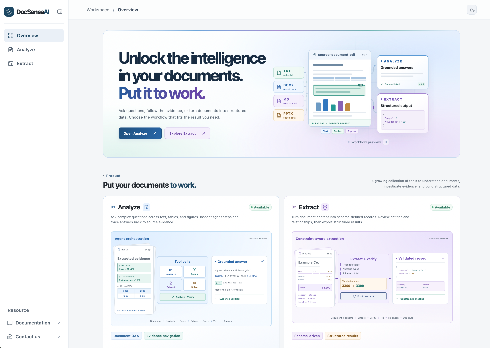

# DataMosaic

[](https://www.python.org/)
[](./web/)

<p align="center">
  
</p>


**A task-driven Document AI system for turning information from complex data sources into answers and structured data.**

Given a task **Q** and available sources, DataMosaic is built around three complementary capabilities:

- **Agentic workflow orchestration:** decompose Q, choose the next operation, and refine the workflow as new evidence appears.
- **Extraction from raw data:** locate and interpret information in source documents, including text, tables, and visual content.
- **Inference from model memory (LLM inference):** synthesize, compare, or reason when the answer is not a literal field in the source. Model-only inferences should be distinguished from claims grounded in the input.

These capabilities are organized into task-oriented modules:

The homepage uses a top navigation bar: **Application → Extract / Chat** opens DBMosaic and DocPilot respectively; **Resource → Documentation / Research Paper** opens the repository and the site's `/research/` publication list. **Organization** opens HKUSTDial, and **Contact us** opens the repository's issue form. On smaller screens, navigation is available through the menu button. The research page groups the three publications below by year and provides PDF and code links; it supports direct access and refresh through the existing portal fallback.

| Engine / Module | Repository | What it does | Output |
| --- | --- | --- | --- |
| **Analyze** (`/analyze/`) | [DocPilot](https://github.com/HKUSTDial/DocPilot) | Investigates questions across long visual documents and follows evidence across pages | An answer with agent steps and navigable source evidence |
| **Extract** (`/extract/`) | [DBMosaic](https://github.com/HKUSTDial/DBMosaic) | Collects entities, fields, and relationships from documents under a target structure | Structured records and a database to inspect or export |

## Related Work

This work is associated with three publications:

[1] **Zhengxuan Zhang**, Zhuowen Liang, Jiazhuo Chen, Haixun Wang, and Nan Tang. *Document-to-Database: Extraction Meets Relational Semantics.* VLDB, 2026. [[PDF](https://www.vldb.org/pvldb/vol19/p2522-zhang.pdf)]

[2] **Zhengxuan Zhang**, Zhuowen Liang, Haixun Wang, and Nan Tang. *DataMosaic: An Interactive Demonstration of Constraint-Driven Document-to-Database Construction.* VLDB Demo, 2026. [[PDF](https://www.vldb.org/pvldb/vol19/p4570-zhang.pdf)]

[3] **Zhuowen Liang**, Xiaotian Lin, Yuyu Luo, Haixun Wang, and Nan Tang. *DocPILOT: Interactive Agent Orchestration and Training for Long Visual Document Understanding.* arXiv, 2026. [[PDF](https://arxiv.org/pdf/2610.21327)]

## Installation

Clone DataMosaic with its engine submodules:

```bash
git clone --recurse-submodules https://github.com/HKUSTDial/DataMosaic.git
cd DataMosaic
cp module/DBMosaic/llm/.env.example module/DBMosaic/llm/.env
```

Both engine submodules use public HTTPS repository URLs. If you cloned without submodules, run `git submodule update --init --recursive`. Set your DBMosaic model credentials in the untracked `module/DBMosaic/llm/.env`; configure DocPilot's model in its web **Model Settings**. Do not commit credentials.

Choose a runtime:

- **Docker:** Install Docker Engine and Compose. The containers build the engine and frontend dependencies; no host Python or Node.js environment is needed.
- **Local script:** Install Python 3.11, Node.js 20.19+ (or 22.12+) with npm, `rsync`, and `curl`. Set up `module/DocPilot/.venv` and `module/DBMosaic/.venv`, and install both engines' frontend dependencies. Follow the [DocPilot installation and interactive demo guide](module/DocPilot/README.md) and [DBMosaic quick start](module/DBMosaic/README.md) for the engine-specific steps. The script expects these environments and `node_modules` directories to exist; it does not install them.

For deployment details, including MinerU model preparation, see [deploy.md](deploy.md).

## Quick start

### Docker

Create the root deployment configuration, then start the stack:

```bash
cp .env.example .env
docker compose config --quiet
docker compose up --build -d
docker compose ps
```

The root `.env` controls deployment settings such as the web bind address. The first build downloads dependencies and may take time. Only the web entry point is published to the host by default.

### Local script

After installing the two engines as described above, install the portal frontend and start all local services:

```bash
npm --prefix web ci
./start.sh
```

The script builds the three frontends and starts both engines and the portal. Keep the terminal open; press `Ctrl+C` to stop the services. It uses local ports `8001`, `8008`, `5000`, `8765`, and `8080`, so stop a running Docker stack before using the script.

With either method, open **http://127.0.0.1:8080** and choose the module for your task.

## Analyze: agentic intelligence for long visual documents

**Analyze** handles questions whose answers are scattered across pages or encoded in tables, charts, figures, and document layout. Powered by DocPilot, a state-aware agent navigates the document, retrieves text and visual evidence, inspects relevant regions, performs computation when needed, and checks whether the answer is grounded. If the evidence is incomplete, it can continue the search instead of forcing a one-shot response.

Pair the workflow with a strong multimodal LLM for high-quality document analysis. DocPilot also supports compact models trained on individual document-solving abilities and complete interaction trajectories; trained action-tag models can be served through vLLM for a smaller, self-hosted deployment.

1. Open **Analyze** from the home page. In **Model Settings**, choose **Custom** for a multimodal LLM or **vLLM** for a trained DocPilot action-tag model, then enter the endpoint, model, and any required key.
2. Keep **Default** selected for the agentic workflow. Import a PDF into **Workspace**, wait until MinerU marks it **Ready**, then add it to the conversation.
3. Ask your question. Follow the agent steps as the answer is produced, and click an evidence reference to locate it in the PDF viewer.

For a direct multimodal question without the DocPilot pipeline, switch to the **Chat** agent and attach a PDF or image in the composer. Default-agent PDF preprocessing requires MinerU models; see the [DocPilot setup guide](module/DocPilot/README.md) and [deployment notes](deploy.md) before the first real run.

## Extract: constraint-aware document-to-database/table

**Extract** turns collections of raw documents into structured, relational data. Powered by DBMosaic, it uses a natural-language objective or an explicit schema to identify entities, attributes, and relationships, then runs an orchestrated **extraction → verification → repair** loop. Schema rules, foreign keys, and business constraints guide targeted corrections, so the result is more than a list of isolated fields.

Use it when you need a reusable database—for example, consolidating companies, reporting periods, revenue, and income across financial reports—and correctness depends on relationships across records as well as individual values.

1. Open **Extract** from the home page. Upload source files to the file library and select the ones to process.
2. Under **Processing Method**, choose **Description** to specify the desired information in natural language, or **Schema** to define tables, fields, and relationships.
3. Click **Begin Analysis**, follow the extraction and verification stages, then inspect the generated records and database. Export the result from the DBMosaic workspace if needed.

The button is enabled only when at least one file is selected and the description or schema is valid. Configure DBMosaic's model credentials before running a task; see its [README](module/DBMosaic/README.md) for supported formats and schema details.

## Project layout

```text
DataMosaic/
├── web/                 # Unified entry page and reverse proxy
├── api/                 # Platform API
├── module/
│   ├── DocPilot/        # Analyze engine (Git submodule)
│   └── DBMosaic/      # Extract engine (Git submodule)
├── docker-compose.yml  # Web, API, and both engines
```

The engines are pinned Git submodules under `module/`; their source code is maintained in their upstream repositories.

Analyze and Extract currently retain separate uploaded files, histories, and results; switching between them does not transfer data automatically. Docker stores their runtime data in named volumes, including DocPilot's workspace, runs, and MinerU models, and DBMosaic's uploads, history, and outputs. `docker compose down` keeps those volumes; **do not use `docker compose down -v` if you want to keep your data**. For local development without Docker, see [deploy.md](deploy.md).

The default web bind address is `127.0.0.1:8080`. For access from another machine on a trusted network, set `DATAMOSAIC_WEB_BIND=0.0.0.0` in `.env` and protect the service with a firewall or authentication proxy. This entry point has no built-in user authentication and must not be exposed directly to the public Internet.

Naming: the platform uses `DATAMOSAIC_*` environment variables, the DBMosaic Extract engine uses `DBMOSAIC_*`, and DocPilot keeps `DOCPILOT_*`. Update any external shell exports or service configuration to these names. The `datamosaic` Compose service, Docker volume names, browser theme storage keys, and DataMosaic publication title are retained.
